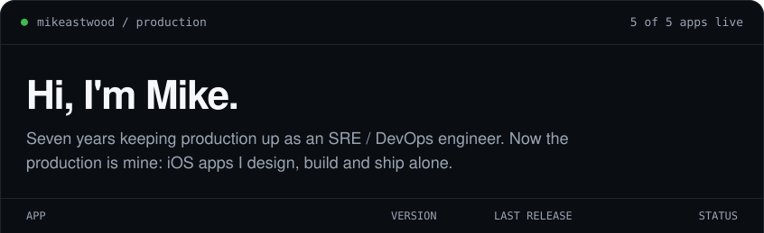
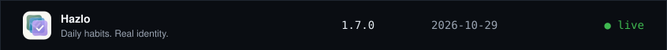
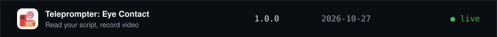
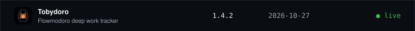
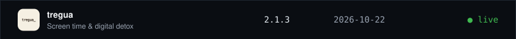
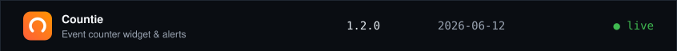
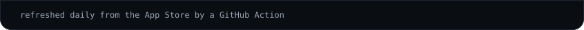
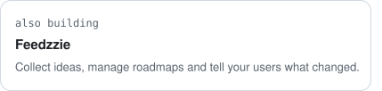
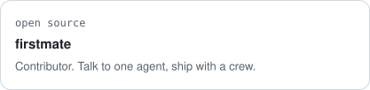

<!-- production:start -->

 
 
 
 
 
 

<!-- production:end -->

Chilean, living in Spain. Once it became clear how powerful LLMs are, I decided to build my own apps and to support open source projects. Building in public on [X](https://x.com/m1keastwood).

<!-- cards:start -->
<a href="https://feedzzie.com"><picture><source media="(prefers-color-scheme: dark)" srcset="assets/profile/card-feedzzie-dark.svg"></picture></a><a href="https://github.com/kunchenguid/firstmate"><picture><source media="(prefers-color-scheme: dark)" srcset="assets/profile/card-firstmate-dark.svg"></picture></a>
<!-- cards:end -->

[mikeastwood.dev](https://mikeastwood.dev) · [X](https://x.com/m1keastwood) · [LinkedIn](https://www.linkedin.com/in/pulgarmichael) · [Instagram](https://instagram.com/mikeastwood) · [mike@mikeastwood.dev](mailto:mike@mikeastwood.dev)
